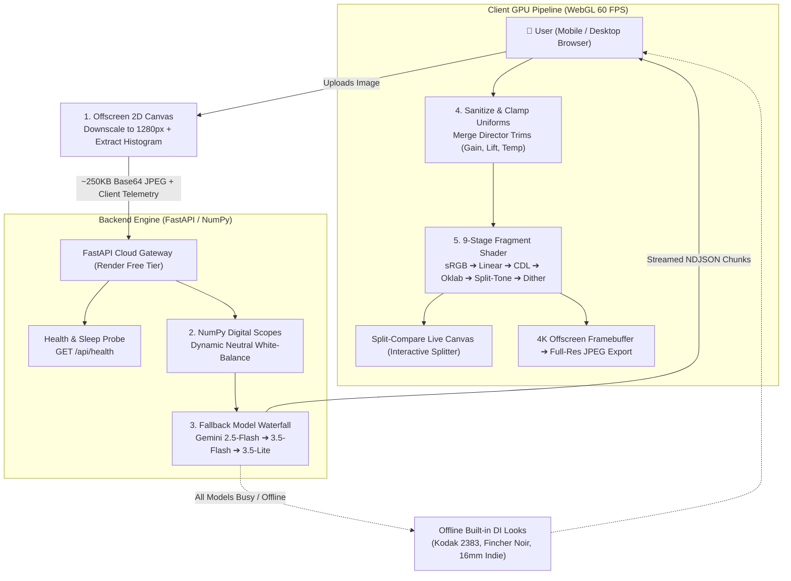
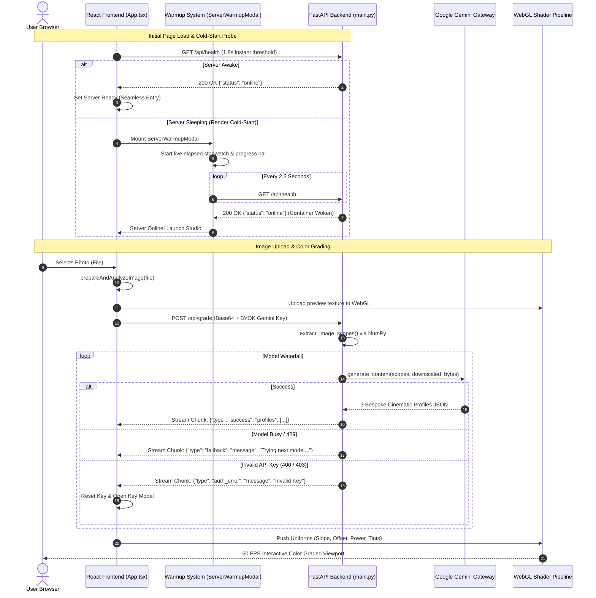

# 🎬 Cinematic AI Color Engine

A production-grade Hollywood Digital Intermediate (DI) color grading platform powered by **WebGL 2.0 fragment shaders**, **perceptual Oklab color science**, and **Google Gemini Multimodal AI**.

The system analyzes exposure, dynamic range, and digital scopes from uploaded photographs to generate 3 visually distinct cinematic looks in real time. It renders at **60 FPS** directly on the client's GPU, features real-time non-destructive Director Trim controls, and exports at **4K full resolution**.

---

## 📑 Table of Contents
1. [System Architecture Overview](#-system-architecture-overview)
2. [End-to-End Architectural Pipeline](#-end-to-end-architectural-pipeline)
3. [Client-Side Pre-Processing & Telemetry](#-client-side-pre-processing--telemetry)
4. [Backend Digital Scopes & White-Balance Engine](#-backend-digital-scopes--white-balance-engine)
5. [Multimodal AI Reasoning & Waterfall Architecture](#-multimodal-ai-reasoning--waterfall-architecture)
6. [Render Cloud Lifecycle & Auto-Warmup System](#-render-cloud-lifecycle--auto-warmup-system)
7. [WebGL Fragment Shader Pipeline (Color Science)](#-webgl-fragment-shader-pipeline-color-science)
8. [High-Resolution GPU Export Engine](#-high-resolution-gpu-export-engine)
9. [Bring-Your-Own-Key (BYOK) Security Model](#-bring-your-own-key-byok-security-model)
10. [Quick Start & Deployment](#-quick-start--deployment)

---

## 🏛️ System Architecture Overview

The system is architected as a distributed hybrid topology:
- **Client Tier (Browser):** React 19 + TypeScript frontend executing hardware-accelerated WebGL fragment shaders for zero-latency 60 FPS previews and client-side image downscaling.
- **Edge / Static Host:** Vercel Global Edge Network serving the compiled SPA assets.
- **AI Backend Tier:** FastAPI (Python 3.12) running in a Docker container on Render, responsible for extracting chromatic scopes, enforcing Pydantic contracts, and managing the Gemini waterfall.
- **Intelligence Tier:** Google Gemini 2.5/3.5 Flash Multimodal models operating as the AI Digital Intermediate (DI) colorist.



---

## 🔄 End-to-End Architectural Pipeline



---

## ⚡ Client-Side Pre-Processing & Telemetry

Before transmitting data over the network, [`src/utils/imageAnalysis.ts`](file:///d:/VS%20Code/ai-colour-grader/src/utils/imageAnalysis.ts) performs edge pre-processing:

1. **Aspect-Preserving Downscaling:**
   The image is drawn onto an offscreen 2D canvas constrained to a maximum bounding box of `1280px`. This compresses megapixel camera files into an ultra-lean `~250KB` JPEG base64 payload (quality `0.85`), minimizing upload latency and token consumption.
2. **Rec.709 Luminance Histogram:**
   Iterates through pixel byte buffers in chunks of 4 (`R, G, B, A`) to calculate relative luminance:
   $$Y = \text{round}(0.2126R + 0.7152G + 0.0722B)$$
   Populates a 256-bin histogram in memory.
3. **Dynamic Range Boundary Extraction:**
   Calculates the 2nd percentile ($P_2$, shadow floor) and 98th percentile ($P_{98}$, highlight ceiling) to prevent speculative outliers or dead pixels from corrupting the dynamic range ratio:
   $$\text{Dynamic Range} = \frac{P_{98} - P_2}{255}$$
4. **Edge Color Cast Estimation:**
   Samples midtone pixels ($51 \le Y \le 204$) to categorize the ambient illumination as `warm`, `cool`, `greenish`, or `neutral`.

---

## 🧮 Backend Digital Scopes & White-Balance Engine

When [`backend/main.py`](file:///d:/VS%20Code/ai-colour-grader/backend/main.py) receives the image, it executes advanced NumPy digital scopes in `extract_image_scopes()`:

### The Problem: Naive RGB Midtone Pollution
In conventional color analysis, averaging all midtones produces false readings when dominant colored objects exist in the frame (e.g., a massive green birthday hedge, a bright yellow painted wall, or vibrant blue clothing). Naive averages cause the AI to believe the light source itself is green or yellow, leading to over-corrected, sickly magenta grades.

### The Solution: Dynamic Achromatic Surface White-Balance
```python
chroma_approx = np.max(arr, axis=2) - np.min(arr, axis=2)
mid_mask = (luma > 0.20) & (luma < 0.80)

if np.any(mid_mask):
    chroma_mid = chroma_approx[mid_mask]
    # Dynamically find the 30th percentile of midtone chroma, strictly capped at 0.10
    neutral_threshold = min(float(np.percentile(chroma_mid, 30)), 0.10)
    achromatic_mid_mask = mid_mask & (chroma_approx <= neutral_threshold)
    ...
```

1. **Chroma Span Calculation:** Approximates pixel chroma as $\max(R, G, B) - \min(R, G, B)$.
2. **Dynamic 30th Percentile Capped at 0.10:** True neutral surfaces (white clothing, gray asphalt, concrete, clouds) have low chroma ($< 0.10$). Saturated background elements (green foliage $\approx 0.26$) are strictly excluded.
3. **Telemetry Report:** Telemetry sent to Gemini includes:
   - Dynamic Range Span ($P_{98} - P_2$)
   - Midtone Absolute RGB from Achromatic Surfaces
   - Warmth Ratio ($R/B$) where $1.00 = \text{Neutral}$
   - Green/Magenta Balance Ratio where $1.00 = \text{Balanced}$

---

## 🤖 Multimodal AI Reasoning & Waterfall Architecture

### Mathematical Contract & Pydantic Schema
Gemini acts as an autonomous Digital Intermediate (DI) colorist. It is constrained by a strict mathematical contract defined in Pydantic:

| Parameter | Type | Valid Range | Function |
| :--- | :--- | :--- | :--- |
| `slope` | `[R, G, B]` | `[0.80, 1.20]` | RGB Gain multiplier (white balance & highlight exposure) |
| `offset` | `[R, G, B]` | `[-0.04, 0.04]` | RGB Shadow lift/cut (black level anchor) |
| `power` | `[R, G, B]` | `[0.80, 1.22]` | Midtone gamma exponent (contrast & color separation) |
| `shadow_tint_rgb` | `[R, G, B]` | `[0.28, 0.72]` | Perceptual shadow split-toning vector in Oklab |
| `highlight_tint_rgb` | `[R, G, B]` | `[0.28, 0.72]` | Perceptual highlight split-toning vector in Oklab |
| `saturation` | `float` | `[0.75, 1.25]` | Global color vibrancy multiplier |

### 3 Bespoke Profiles Contract
Every AI grading operation must produce three distinct looks:
1. **Natural 35mm Print:** Clean white balance neutralizing ambient cast, crisp contrast ($P \in [1.02, 1.08]$), subtle cool shadows, and warm highlights.
2. **Complementary Teal & Amber:** Genre split with rich amber highlights ($H = [0.62, 0.54, 0.38]$), heavy teal shadows ($S = [0.34, 0.52, 0.65]$), and deep black crush ($O \in [-0.025, -0.010]$).
3. **Vintage Golden Archival:** Low-contrast soft archival curve ($P \in [0.85, 0.92]$), lifted matte blacks ($O \in [+0.015, +0.030]$), warm bronze shadow base, and muted saturation.

### Waterfall Resiliency
To ensure zero failed requests under Google AI Studio API rate limits or quota spikes, the backend executes an asynchronous waterfall:
$$\text{Gemini 2.5 Flash} \xrightarrow{\text{on 429/timeout}} \text{Gemini 3.5 Flash} \xrightarrow{\text{on 429/timeout}} \text{Gemini 3.5 Flash Lite} \xrightarrow{\text{on failure}} \text{Built-in DI Presets}$$

* **Auth Error Breakout:** If the user enters an invalid or revoked API key (`400 API_KEY_INVALID` or `403 PERMISSION_DENIED`), the backend **immediately breaks out** of the loop, emitting an `auth_error` event so the client can prompt the user rather than wasting time trying fallback models.

---

## ☁️ Render Cloud Lifecycle & Auto-Warmup System

Render's free tier spins down idle instances after 15 minutes of inactivity. When a request arrives, a cold boot takes **30 to 50 seconds**. 

To prevent user confusion or premature fallbacks to offline presets:
1. **Instant Health Probing:** On mount, [`App.tsx`](file:///d:/VS%20Code/ai-colour-grader/src/App.tsx) probes `GET /api/health` with a 1.8-second threshold.
2. **Warmup Overlay ([`ServerWarmupModal.tsx`](file:///d:/VS%20Code/ai-colour-grader/src/components/ServerWarmupModal.tsx)):** If the server is sleeping, the application displays a cinematic warm-up screen featuring:
   - Live elapsed seconds stopwatch (`⏳ Elapsed: 28s`).
   - Ping attempt counter (`Pings: #11`).
   - Calibrated boot progress indicator.
   - Non-technical explanation of the Render free tier lifecycle.
   - Emergency bypass button (`⚡ Skip & Use Offline Presets Immediately`).
3. **Sleep Recovery:** If a user leaves the browser tab open and returns after 20 minutes, any grading attempt that encounters a `502 / 503 / 504` or connection drop automatically surfaces the warmup screen to wake the backend and re-grade the active photo.

---

## 🎨 WebGL Fragment Shader Pipeline (Color Science)

The core rendering engine in [`src/shaders/gradeShaders.ts`](file:///d:/VS%20Code/ai-colour-grader/src/shaders/gradeShaders.ts) executes directly on the GPU across 9 discrete stages:

```mermaid
flowchart LR
    sRGB["sRGB Input"] --> Linear["1. Linearize + Lens Falloff"]
    Linear --> CDL["2. ASC-CDL + Toe Guard"]
    CDL --> Oklab["3. Oklab & Polar Oklch"]
    Oklab --> Skin["4. 3D Skin Vector Gate"]
    Skin --> LUT["5. Kodak 2383 Convergence"]
    LUT --> Split["6. Perceptual Split-Toning<br/>(Luminance-Gated Shield)"]
    Split --> Gamut["7. Soft-Knee Saturation"]
    Gamut --> Curve["8. Pivoted Filmic Curve<br/>+ Subtractive Density"]
    Curve --> Dither["9. Dither & Grain ➔ Output"]
```



### 1. Optical Lens Falloff (Power Window)
Simulates cinema prime transmission by applying subtle cosine-fourth optical falloff towards the edges:
$$\text{distSq} = \|\text{UV} - 0.5\|^2, \quad \text{Falloff} = 1.0 - \text{smoothstep}(0.10, 0.55, \text{distSq}) \cdot 0.18$$

### 2. Primary ASC-CDL with Adaptive Toe Guard
Applies American Society of Cinematographers Color Decision List transforms:
$$\text{CDL} = \max(\text{Linear} \cdot \text{Slope} + \text{safeOffset}, 0.0)^{\text{Power}}$$
* **Toe Guard:** Positive offset is gated near zero so black night skies remain locked to black, while allowing negative offsets to anchor hazy shadows:
  $$\text{safeOffset} = \text{mix}(\min(\text{Offset}, 0), \text{Offset}, \text{smoothstep}(0.0, 0.03, Y_{\text{raw}}))$$

### 3. Oklab & Polar Oklch Space Transformation
Converts linear RGB to perceptual Oklab ($L, a, b$) and polar coordinates ($L, C, h$):
$$\text{Chroma} = \sqrt{\max(a^2 + b^2, 0.0)}, \quad \text{Hue} = \text{atan}(b, \text{safeY})$$
* **Hardware-Proof GLSL 1.00 Guard:** On mobile GPUs (Qualcomm Adreno, ARM Mali), ternary expressions (`c ? a : b`) evaluate both sides in registers, and $\text{atan}(0, 0)$ returns `NaN`, turning the screen black. The shader enforces:
  $$\text{safeY} = |a| < 0.0001 \;?\; 0.0001 : a$$
  guaranteeing no register ever evaluates a zero-divisor.

### 4. Human Skin Vector Protection
Isolates human melanin hue vectors centered at $\approx 0.88\text{ rad}$ in Oklab:
$$\text{skinMask} = \text{skinHue} \cdot \text{skinChroma} \cdot \text{skinLuma}$$
Preserves healthy skin pigmentation from unnatural color contamination during aggressive grading.

### 5. Kodak 2383 Oklch Hue Convergence
Emulates classic Kodak 2383 print stock dye coupling by converging acidic yellow-greens towards golden amber ($1.75\text{ rad}$) and cyan-blues towards deep film teal ($-1.65\text{ rad}$):
$$\Delta_{\text{yellow}} = \frac{h - 1.75}{0.45}, \quad \Delta_{\text{blue}} = \frac{h + 1.65}{0.50}$$

### 6. Perceptual Split-Toning with Luminance-Gated Achromatic Shield
Applies shadow tinting ($L \in [0.02, 0.54]$) and highlight tinting ($L \in [0.48, 0.96]$) in Oklab space:
```glsl
// Gated above the shadow zone (L > 0.24) so deep shadow teal remains 100% active!
float achromaticShield = (1.0 - smoothstep(0.008, 0.035, min(origChroma, chroma))) * smoothstep(0.24, 0.42, L);
float shadowProtect = 1.0 - max(skinMask * 0.90, achromaticShield * 0.70);
float highProtect = 1.0 - max(skinMask * 0.75, achromaticShield * 0.85);

lab.y += (sTintLab.y * sMask * shadowProtect + hTintLab.y * hMask * highProtect) * 0.95;
lab.z += (sTintLab.z * sMask * shadowProtect + hTintLab.z * hMask * highProtect) * 0.95;
```
* **Shadow Split-Toning Preservation:** Because chroma naturally collapses as $L \to 0$, gating the shield above $L > 0.24$ ensures teal shadow tones remain 100% active in dark regions, while neutral white shirts and gray midtone concrete are shielded from heavy tint staining.

### 7. Pivoted Filmic Curve & Subtractive Density
Contrast is dynamically adjusted via a pivoted S-curve:
$$\Delta = L - 0.55, \quad \text{curvedL} = \text{clamp}(L + \Delta \cdot S_{\text{strength}} \cdot (1 - \text{norm}^2), 0.0, 1.0)$$
* **Subtractive Film Density:** Emulates real photochemical film where saturated colors naturally absorb light and darken, preventing digital clipping on saturated neon elements.

### 8. Emulsion Dither & Sub-Pixel Grain
Applies procedural monochrome film grain gated in midtones ($L \in [0.05, 0.98]$) to eradicate 8-bit banding artifacts:
$$\text{grainHash} = \text{fract}(\sin(\text{clamp}(\text{dot}(\text{UV}, [12.9898, 78.233]), -100, 100)) \cdot 437.5854)$$

---

## 💾 High-Resolution GPU Export Engine

When the user exports their photograph ([`src/utils/exportImage.ts`](file:///d:/VS%20Code/ai-colour-grader/src/utils/exportImage.ts)):

1. **Hardware-Aware Canvas Allocation:** Reads `gl.getParameter(gl.MAX_TEXTURE_SIZE)` and clamps the export canvas to the device's hardware maximum (up to 4096px 4K).
2. **Offscreen 2D Downscaler:** For ultra-high-resolution smartphone photos (48MP, 108MP) that exceed GPU memory limits, an offscreen 2D canvas scales the image cleanly before creating the WebGL texture.
3. **Pipeline Synchronization:** Executes `gl.finish()` to force the GPU rasterization pipeline to complete before `canvas.toBlob()` accesses the framebuffer, preventing black-image exports on mobile Safari and Chrome.
4. **Android Download Manager Safe Revocation:** `URL.revokeObjectURL` is delayed by 60 seconds via `setTimeout`, preventing Android Download Manager race conditions from corrupting downloads.

---

## 🔐 Bring-Your-Own-Key (BYOK) Security Model

To ensure the platform remains 100% free and sustainable without recurring operational costs for the maintainer:

- **Host Wallet Protection:** The backend does **not** inject any master API key. If a request is received without a key, it returns instant built-in DI presets with **zero API cost**.
- **Local Browser Storage:** User keys are held exclusively in browser `localStorage` (`gemini_api_key`) and passed on a per-request basis in the request payload.
- **Stateless Cloud Gateway:** Keys are used solely for the duration of the stream to instantiate `genai.Client(api_key=user_key)` and are never persisted to disk or databases.
- **Instant Re-Grading on Key Connect:** When a user connects a key after uploading an image, the client immediately detects the active image and re-triggers grading without requiring a file re-upload.

---

## 🚀 Quick Start & Deployment

### Run with Docker Compose (Recommended)
```bash
git clone https://github.com/your-username/ai-colour-grader.git
cd ai-colour-grader
docker compose up --build
```
- **Web App:** [http://localhost:3001](http://localhost:3001)
- **FastAPI API & Docs:** [http://localhost:8000/docs](http://localhost:8000/docs)

### Manual Local Setup

#### Backend (FastAPI)
```bash
cd backend
python -m venv venv
# Windows:
.\venv\Scripts\activate
# macOS/Linux:
# source venv/bin/activate
pip install -r requirements.txt
uvicorn main:app --reload --port 8000
```

#### Frontend (React + Vite)
```bash
npm install
npm run dev
```

### Production Deployment
- **Frontend:** Deploy to [Vercel](https://vercel.com) with Environment Variable:
  ```env
  VITE_API_URL=https://your-backend.onrender.com
  ```
- **Backend:** Deploy `backend/` directory to [Render](https://render.com) as a Web Service:
  - **Runtime:** Python 3
  - **Build Command:** `pip install -r requirements.txt`
  - **Start Command:** `uvicorn main:app --host 0.0.0.0 --port $PORT`
